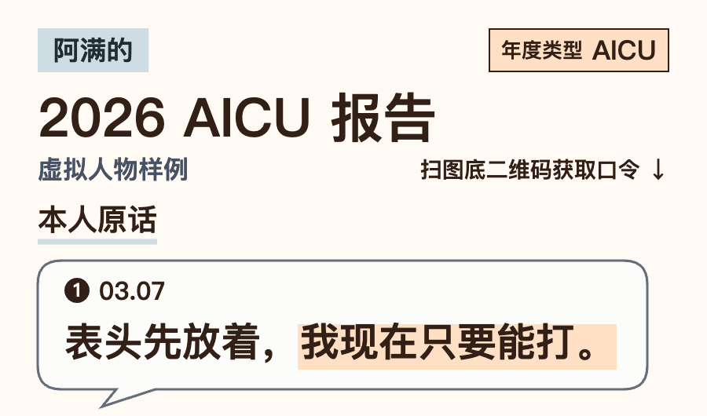
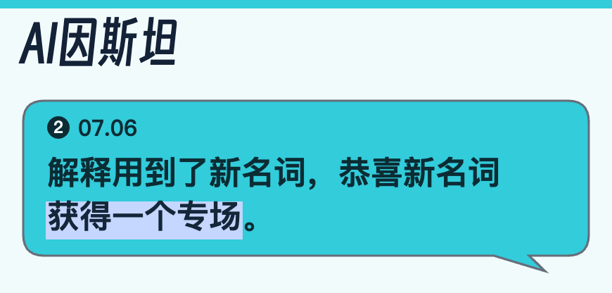
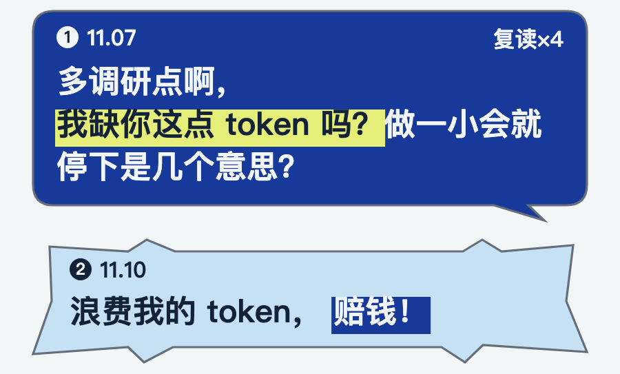

<p align="center">
  <a href="https://xn--sxrw8m230b.com/PUAI/"></a>
</p>

<p align="center">
  <a href="https://xn--sxrw8m230b.com/PUAI/"></a>
</p>

点「复制给 ChatGPT」，按需填署名，把一句口令发到常用对话。已安装的助手调用 `$puai`；能联网的助手也可读取同一份公开技能说明。PUAI 去聊天里翻你的原话，用项目自带的版式出图。能显示图片的对话直接收图，文字对话点开网页预览。[做我的年度报告](https://xn--sxrw8m230b.com/PUAI/)

如果助手打不开技能链接，可把[技能说明文件](https://xn--sxrw8m230b.com/PUAI/skill.txt)作为附件发给它，再发同一句口令。

## 翻三张场景样刊

<p align="center">
  <a href="https://xn--sxrw8m230b.com/PUAI/themes/#aicu"></a>
  <a href="https://xn--sxrw8m230b.com/PUAI/themes/#einstein"></a>
  <a href="https://xn--sxrw8m230b.com/PUAI/themes/#support"></a>
</p>

还有六种相处方式可以翻。点主题看完整报告。

[AI迪生 · 脑洞接力](https://xn--sxrw8m230b.com/PUAI/themes/#edison)　[AI特全体 · 模型互评](https://xn--sxrw8m230b.com/PUAI/themes/#all)　[AI的教育 · 给它补课](https://xn--sxrw8m230b.com/PUAI/themes/#teach)<br>
[AI在心口难开 · 措辞代练](https://xn--sxrw8m230b.com/PUAI/themes/#hush)　[AI咋咋地 · 你来拍板](https://xn--sxrw8m230b.com/PUAI/themes/#free)　[PUAI · 在线追责](https://xn--sxrw8m230b.com/PUAI/themes/#puai)

## 唐某的两笔 token 账

<p>
  <a href="https://xn--sxrw8m230b.com/PUAI/sample.html"></a>
</p>

[看不愿透露姓名的唐某的完整报告 ↗](https://xn--sxrw8m230b.com/PUAI/sample.html)

## 用自己的 Agent 生成

```sh
npx skills add TANGXTONG1/PUAI
```

装好后说「用 PUAI 生成我的年度报告」。Agent 可以在本地核对获准读取的记录并导出 PNG。有日期就能画发言日历，有用量日志还能查那段时间烧了多少 token。[下载 skill](https://xn--sxrw8m230b.com/PUAI/PUAI-skill.zip?v=af137f2155) · [阅读 SKILL.md](SKILL.md)

<details>
<summary>生成命令与运行环境</summary>

```sh
python3 scripts/build_report.py --input /path/to/report.json --style comic --output /path/to/share.html
node scripts/export_png.mjs --input /path/to/share.html --output /path/to/share.png
```

以上命令使用 Python、Node.js、Playwright 与 Chromium。有 Python、Pillow 和中文字体的文件环境还可以独立运行 `python scripts/render_chat_png.py report.txt PUAI-2026.png`。[输入格式](references/report-schema.md) · [PNG 导出](references/png-export.md)

</details>

<details>
<summary>样刊、配色与字体</summary>

[九份完整报告](https://xn--sxrw8m230b.com/PUAI/themes/) · [九型色样](https://xn--sxrw8m230b.com/PUAI/palettes/neon/nine/) · [亮底霓虹](https://xn--sxrw8m230b.com/PUAI/palettes/neon/) · [艺术印色](https://xn--sxrw8m230b.com/PUAI/palettes/art/) · [48 款配色](https://xn--sxrw8m230b.com/PUAI/palettes/atlas/)

报告标题使用得意黑 Smiley Sans。[字体许可](assets/SmileySans-OFL.txt)

</details>
