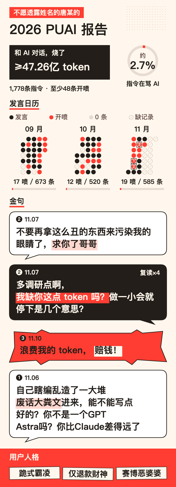

<p align="center">
  
</p>

<p align="center">
  把你的 AI 对话（主要是，PUA AI）做成一张年度报告：<br>
  token 用量、开喷比例、发言日历、原话金句和用户人格。
</p>

<p align="center">
  <a href="https://xn--sxrw8m230b.com/PUAI/"><strong>在线入口</strong></a>
  &nbsp; · &nbsp;
  <a href="https://xn--sxrw8m230b.com/PUAI/PUAI-skill.zip">下载 skill</a>
  &nbsp; · &nbsp;
  <a href="#报告示例">报告示例</a>
  &nbsp; · &nbsp;
  <a href="SKILL.md">Skill 说明</a>
</p>

## 开始使用

把 `XXX` 换成你的昵称，复制给能读取链接、运行代码的 Agent：

```text
叫我「XXX」，生成我调教 AI 的年度报告长图。
参考该 skill：https://github.com/TANGXTONG1/PUAI
```

<details>
<summary>通过命令行安装</summary>

```bash
npx skills add TANGXTONG1/PUAI
```

已安装时：`叫我「XXX」，用 PUAI 生成我的年度报告长图。`

</details>

Agent 无法访问你的历史时，上传聊天导出文件即可。生成在你的 Agent 环境中完成。

## 报告示例

<p align="center">
  <a href="https://xn--sxrw8m230b.com/PUAI/preview.png">
    
  </a>
</p>

<p align="center">
  <a href="https://xn--sxrw8m230b.com/PUAI/sample.html">查看完整报告</a>
</p>

原话只精选，不改写；没有记录不编数字；私人工作背景不上图。每个人的金句和标签都取自自己的记录。

<details>
<summary>给 Agent：运行环境与生成流程</summary>

读取 [SKILL.md](SKILL.md)，按其中流程整理用户授权的记录，再运行：

```bash
python3 scripts/build_report.py --input /path/to/report.json --style comic --output /path/to/share.html
node scripts/export_png.mjs --input /path/to/share.html --output /path/to/share.png
```

Python 3.9+、Node.js 20+、Playwright 和 Chromium；缺少依赖时见 [PNG 导出说明](references/png-export.md)。输入格式见 [report-schema.md](references/report-schema.md)，无需用户手填。

字体得意黑 Smiley Sans 随包保留 [OFL 许可](assets/SmileySans-OFL.txt)。独立创意项目。

</details>
